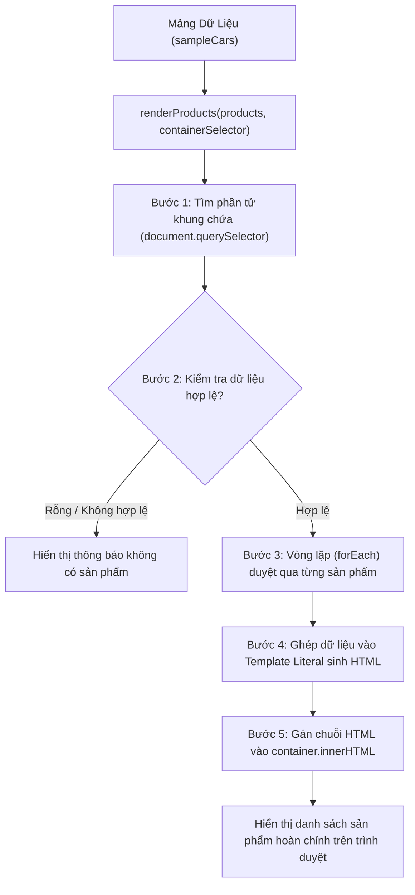

# GIẢI THÍCH LOGIC TRUYỀN DỮ LIỆU VÀ HIỂN THỊ DANH SÁCH SẢN PHẨM / DỊCH VỤ

Tài liệu này giải thích chi tiết và đơn giản cách thức hàm JavaScript `renderProducts` tiếp nhận danh sách dữ liệu mẫu và tự động sinh ra giao diện người dùng (UI) trên trang web thay vì phải viết mã HTML thủ công cho từng sản phẩm.

---

## 1. Tổng Quan & Mục Tiêu

### Vấn đề khi viết HTML tĩnh:
- Khi có 6 chiếc xe (hoặc hàng trăm sản phẩm), lập trình viên phải sao chép - dán cùng một đoạn mã HTML nhiều lần.
- Dễ sai sót cú pháp, tốn dung lượng file, khó bảo trì.
- Khi cần thay đổi giá hoặc thông tin một sản phẩm, phải mở file HTML để tìm kiếm và sửa đổi từng dòng.

### Giải pháp dùng JavaScript:
- **Tách biệt Dữ liệu (Data) và Giao diện (UI)**:
  - Dữ liệu được lưu trong một danh sách (mảng các đối tượng JavaScript).
  - Giao diện được định nghĩa bằng một **khuôn mẫu (Template)** duy nhất.
- Một **hàm JavaScript kết hợp với vòng lặp** sẽ tự động "đổ" dữ liệu vào khuôn mẫu và gắn lên trang web.

---

## 2. Cấu Trúc Dữ Liệu Đầu Vào (Sample Data)

Dữ liệu được tổ chức dưới dạng **Mảng các Đối tượng (Array of Objects)** có tên là `sampleCars` trong file `script.js`.

Mỗi đối tượng đại diện cho một sản phẩm/chiếc xe với các thông tin độc lập:

```javascript
const sampleCars = [
    {
        id: 1,
        name: "Phantom Grand Coupe",
        category: "sedan",
        tag: "Phiên bản giới hạn",
        image: "https://images.unsplash.com/photo-1555215695-3004980ad54e?...",
        categoryBadge: "Sedan Vị Lai",
        rating: 4.9,
        reviewsCount: 48,
        description: "Sedan coupe đỉnh cao với nội thất bọc da Nappa cao cấp...",
        specs: [
            { icon: "power", text: "V8 Twin-Turbo 625hp" },
            { icon: "speed", text: "0-100: 3.2s" },
            { icon: "drive", text: "AWD Toàn Thời Gian" }
        ],
        price: "6.890.000.000 ₫",
        buttonText: "Nhận Báo Giá"
    },
    // ... các sản phẩm tiếp theo
];
```

### Ý nghĩa các trường dữ liệu:
- `id`: Mã định danh duy nhất của sản phẩm.
- `name`: Tên sản phẩm/dòng xe.
- `category`: Phân loại sản phẩm (ví dụ: `sedan`, `suv`, `electric`) phục vụ bộ lọc hiển thị.
- `image`: Đường dẫn URL hình ảnh sản phẩm.
- `price`: Mức giá hiển thị của sản phẩm.
- `specs`: Mảng chứa các thông số kỹ thuật nổi bật (mỗi thông số gồm biểu tượng `icon` và mô tả `text`).

---

## 3. Cách Truyền Dữ Liệu Vào Hàm `renderProducts`

### 3.1. Khai báo hàm với các tham số (Parameters)

```javascript
function renderProducts(products, containerSelector = "#carsGrid") {
    // ... logic xử lý hiển thị ở đây ...
}
```

Hàm được thiết kế nhận **2 tham số**:
1. **`products`** *(Bắt buộc)*: Mảng danh sách sản phẩm cần hiển thị.
2. **`containerSelector`** *(Tùy chọn, mặc định là `"#carsGrid"`)*: Bộ chọn CSS (selector) trỏ tới thẻ HTML cha sẽ chứa các thẻ sản phẩm.

### 3.2. Thực hiện truyền dữ liệu khi gọi hàm (Argument Passing)

Khi trang web đã tải xong (sự kiện `DOMContentLoaded`), ta truyền mảng `sampleCars` vào hàm:

```javascript
// Gọi hàm và truyền mảng dữ liệu sampleCars vào
renderProducts(sampleCars, "#carsGrid");
```

> **Hình ảnh ẩn dụ dễ hiểu:**  
> Hàm `renderProducts` giống như một **"chiếc máy in"**, còn tham số `sampleCars` là **"tập tài liệu cần in"**. Khi bạn nạp tập tài liệu vào máy và chỉ định vị trí khay giấy (`#carsGrid`), máy sẽ tự động in từng trang ra đúng vị trí đó.

---

## 4. Quy Trình 5 Bước Xử Lý Bên Trong Hàm

Dưới đây là các bước diễn ra bên trong hàm khi nhận được dữ liệu:



### Chi tiết từng bước:

### Bước 1: Xác định vị trí hiển thị trên giao diện (DOM Target)
Hàm sử dụng `document.querySelector` để tìm thẻ chứa danh sách xe trên trang web:
```javascript
const container = document.querySelector(containerSelector);
```

### Bước 2: Kiểm tra dữ liệu (Validation)
Kiểm tra xem danh sách có hợp lệ hay không. Nếu danh sách không có phần tử nào, hàm hiển thị một thông báo thông minh thay vì để trống:
```javascript
if (!Array.isArray(products) || products.length === 0) {
    container.innerHTML = `<p>Hiện chưa có sản phẩm nào để hiển thị.</p>`;
    return;
}
```

### Bước 3: Dùng vòng lặp duyệt qua danh sách dữ liệu (Looping)
Thay vì viết từng thẻ `<article class="car-card">`, hàm dùng vòng lặp `forEach` (hoặc `for...of`, `map`) để đi qua lần lượt từng đối tượng xe trong mảng:
```javascript
let accumulatedHtml = "";

products.forEach((product) => {
    // Với mỗi sản phẩm, tự động sinh mã HTML và cộng dồn lại
    accumulatedHtml += createProductCardHTML(product);
});
```

### Bước 4: Lấy giá trị từng thuộc tính ghép vào mẫu HTML (Template Literals)
Bên trong hàm con `createProductCardHTML`, chúng ta sử dụng cú pháp **Template Literals (dấu backtick `` ` ``)** cùng cú pháp nội suy `${biến}` để đưa trực tiếp dữ liệu vào cấu trúc thẻ:
```javascript
return `
    <article class="car-card" data-category="${item.category}">
        <figure class="car-figure">
            
        </figure>
        <div class="car-info">
            <h3 class="car-name">${item.name}</h3>
            <p class="car-desc">${item.description}</p>
            <strong class="car-price">${item.price}</strong>
        </div>
    </article>
`;
```

### Bước 5: Cập nhật mã HTML vào trang web
Sau khi vòng lặp hoàn thành, toàn bộ chuỗi HTML được gán vào thuộc tính `innerHTML` của phần tử chứa:
```javascript
container.innerHTML = accumulatedHtml;
```
Trình duyệt sẽ ngay lập tức phân tích chuỗi HTML này và kết xuất (render) thành các thẻ sản phẩm hoàn chỉnh trên màn hình với đầy đủ kiểu dáng CSS.

---

## 5. Ví Dụ Trực Quan Khi Thêm Một Sản Phẩm Mới

Nếu sau này showroom nhập thêm một mẫu xe mới, lập trình viên **không cần chỉnh sửa file HTML**, chỉ cần gọi hàm hoặc thêm 1 đối tượng vào mảng:

```javascript
const newCars = [
    {
        id: 7,
        name: "Aura Valkyrie Concept",
        category: "electric",
        tag: "Concept Tương Lai",
        image: "https://images.unsplash.com/photo-1503376780353-7e6692767b70?auto=format&fit=crop&w=800&q=80",
        categoryBadge: "Hypercar Điện",
        rating: 5.0,
        reviewsCount: 12,
        description: "Mẫu xe ý niệm tiên phong trang bị động cơ lượng tử 1.000 mã lực.",
        specs: [
            { icon: "power", text: "Quantum EV 1000hp" },
            { icon: "speed", text: "0-100: 1.9s" },
            { icon: "range", text: "Tầm xa 850 km" }
        ],
        price: "22.500.000.000 ₫",
        buttonText: "Đặt Trước Đặc Quyền"
    }
];

// Chỉ cần truyền dữ liệu mới vào hàm:
renderProducts(newCars, "#carsGrid");
```

---

## 6. Lợi Ích Của Cách Tiếp Cận Này

| Tiêu Chí | Viết HTML Tĩnh Thủ Công | Dùng Hàm JavaScript & Vòng Lặp |
| :--- | :--- | :--- |
| **Dung lượng code** | Lặp lại hàng trăm dòng HTML tương tự nhau | Ngắn gọn, chỉ cần 1 khuôn mẫu (Template) duy nhất |
| **Bảo trì & Cập nhật** | Phải tìm và sửa thủ công từng dòng HTML | Chỉ cần sửa đổi giá trị trong mảng dữ liệu |
| **Khả năng mở rộng** | Rất khó khi có từ vài chục đến hàng nghìn sản phẩm | Rất dễ, hiển thị 5 sản phẩm hay 500 sản phẩm đều dùng chung 1 hàm |
| **Tích hợp Backend / API** | Không thể kết nối động với cơ sở dữ liệu | Rất thuận lợi: Dữ liệu nhận từ `fetch()` từ máy chủ có thể truyền trực tiếp vào hàm |

